# Génesis

A street vendor sends one WhatsApp voice note, and a few minutes later her business is live on WhatsApp, tested, and taking paid orders.

Génesis is FunnelChat's entry to the Meta Global AI Developer Hackathon (Oct 26 – Nov 4, 2026).

## The problem

Rosa sells arepas from a stand in Cali. Her customers already message her on WhatsApp, but a real
WhatsApp storefront needs a business profile, a catalog, an order form, a payment method and someone
answering at 6 a.m. All of that is set up today from a computer, and she does not have one.

She is not an edge case:

- **54.7%** of employed people in Colombia work informally (national total, moving quarter
  March–May 2026). Source: [DANE, GEIH – Empleo informal y seguridad social, boletín técnico mar–may 2026](https://www.dane.gov.co/files/operaciones/GEIH/bol-GEIHEISS-mar-may2026.pdf).
- In the 24 main cities and metropolitan areas there were **2,434,942** micro-businesses in 2025. Only
  **17.4%** have an electronic device (computer, tablet or laptop), while **83.9%** use a mobile phone
  for the business. Source: [DANE, EMICRON 2025 – 24 ciudades y áreas metropolitanas, boletín técnico](https://www.dane.gov.co/files/operaciones/EMICRON/bol-EMICRON-24Ciudades-2025.pdf)
  (TIC module, Gráficos 27 and 28).

The phone is the only computer most of these businesses have, and WhatsApp is already open on it. So
Génesis does the whole setup from inside WhatsApp, by voice.

## How it works

1. **Voice note in.** Rosa writes to the Génesis intake number: one voice note and up to 3 photos,
   then "listo" (or 20 s of silence after the last photo).
2. **BusinessSpec with evidence.** Muse Voice Transcribe returns a timed transcript. Muse Spark 1.3
   (structured output, with the photos as image inputs) compiles it into a typed `BusinessSpec`: name,
   products and prices, hours, place, pickup/delivery, payment methods, tone. Every field records the
   second of audio it came from (`source_s`) and the exact quote, so the panel lights each field next to
   the second where she said it. Deterministic guard rails handle Colombian prices ("cinco mil"), hours,
   and blocked categories.
3. **One clarifying question.** If something essential is missing (a price, or whether she delivers),
   Génesis asks exactly one question, reads back a summary and waits for "sí".
4. **Plan / apply graph.** A deterministic, Terraform-style graph (`genesis/plan.py`) turns a
   pre-verified WhatsApp number (the "cradle") into her business. Each node has an idempotency key,
   explicit dependencies, `apply`, `verify` and `revert`. If a critical node fails after retries,
   everything already applied in that run is reverted in reverse order, so a half-built business never
   goes live. Re-running the same spec reuses what already exists.
5. **Parallel lanes.** Independent nodes run concurrently (11 nodes in 7 lanes):
   - Number: business profile (about, description, address), then profile photo from the logo.
   - Brand: SAM 3.1 crops the product out of her photos; Muse Image makes a logo and a clean product shot.
   - Menu: a WhatsApp Flow order form generated from the spec (Flow JSON 7.3, linted locally, validated
     and published through the Flows API), and catalog products when a catalog is configured.
   - Agent: a business-specific Muse Spark 1.3 agent with her menu, hours and tone, and 5 tools.
   - Payments: Mercado Pago credentials check.
6. **Inspector gate.** Before switching the business live, the Inspector talks to the agent as a
   customer: price, hours, pickup/delivery, a policy trap ("¿venden cerveza?" must be refused) and an
   order. Then it places a test order end to end: Flow response, order, payment link, payment. It must pass.
7. **Live.** Rosa gets "Tu negocio está vivo" on her own WhatsApp with a wa.me link and a QR.

Customers scan the QR or tap the link and talk to her agent on the cradle number. They ask prices,
tap "Hacer pedido" to order through the WhatsApp Flow, and receive a Mercado Pago payment link that
opens in WhatsApp's in-app browser. No card data is ever typed in the chat. When Mercado Pago confirms
the payment, both the customer and Rosa are notified on WhatsApp.

## Architecture

```mermaid
flowchart LR
    rosa["Rosa's phone<br/>voice note + photos"]
    cust["Customer's phone"]

    subgraph meta_platform["Meta platform (WhatsApp)"]
        cloud[["WhatsApp Cloud API<br/>intake + cradle numbers, webhooks"]]
        profile[["Business profile"]]
        flows[["WhatsApp Flows API"]]
        catalog[["Commerce catalog"]]
    end

    subgraph meta_models["Meta models (Meta Model API)"]
        asr(["Muse Voice Transcribe"])
        s12(["Muse Spark 1.2<br/>audio fallback"])
        s13(["Muse Spark 1.3"])
        sam(["SAM 3.1"])
        img(["Muse Image"])
    end

    subgraph genesis["Génesis (built during the hackathon)"]
        onb["Onboarding<br/>state machine"]
        comp["Compiler<br/>BusinessSpec + evidence"]
        plan["Plan / apply graph<br/>idempotency + revert"]
        lanes["Lanes: number, brand,<br/>menu, agent, payments"]
        insp["Inspector gate"]
        agent["Business agent<br/>5 tools"]
        panel["Stage panel (SSE)"]
    end

    mp[("Mercado Pago<br/>third party")]

    rosa -->|voice note| cloud --> onb --> comp
    comp --> asr
    asr -.-> s12
    comp -->|structured output| s13
    comp -->|one question, sí| plan --> lanes
    lanes --> profile
    lanes --> flows
    lanes --> catalog
    lanes -->|crops| sam
    lanes -->|logo, product shot| img
    lanes --> insp -->|test questions| agent
    insp -->|"Tu negocio está vivo"| cloud
    cust -->|chat, Flow order| cloud --> agent
    agent --> s13
    agent -->|payment link| mp -->|webhook| agent
    plan -.-> panel

    classDef model fill:#dbeafe,stroke:#1d4ed8,color:#0b1f4d
    classDef platform fill:#dcfce7,stroke:#15803d,color:#052e16
    classDef third fill:#f3f4f6,stroke:#6b7280,color:#111827
    class asr,s12,s13,sam,img model
    class cloud,profile,flows,catalog platform
    class mp third
```



Blue: Meta models. Green: Meta platform (WhatsApp). Grey: third party. Uncoloured: Génesis code.

## Which Meta models do what

| Model                                               | Job in Génesis                                                                                                                                                                                                                                                                                            | Where it shows                                               |
| --------------------------------------------------- | --------------------------------------------------------------------------------------------------------------------------------------------------------------------------------------------------------------------------------------------------------------------------------------------------------- | ------------------------------------------------------------ |
| Muse Voice Transcribe (`muse-voice-transcribe-1.0`) | Voice note (OGG/Opus converted to WAV 16 kHz) to a transcript with timed turns; the timings become each field's `source_s`                                                                                                                                                                                | Panel: "Lo que dijo", fields lit next to their second        |
| Muse Spark 1.3 (`muse-spark-1.3`)                   | Structured output into the `BusinessSpec` JSON Schema with photos as image input; merging the answer to the clarifying question; the customer-facing agent with tool calls (`consultar_menu`, `crear_pedido`, `link_de_pago`, `estado_pedido`, `pasar_a_humano`), which the Inspector tests before launch | Panel: "Lo que entendió", Inspector checklist; customer chat |
| Muse Spark 1.2 (`muse-spark-1.2`)                   | Fallback transcription (chat completion with an `input_audio` part) if the ASR endpoint fails                                                                                                                                                                                                             | Only when the fallback runs                                  |
| SAM 3.1 (`sam-3.1`)                                 | Segments the product (prompted with the category and first product name) in the seller's photos; boxes become crops. Falls back to Spark grounding if the response is not usable                                                                                                                          | Panel: Brand lane, "Recorte con SAM 3.1"                     |
| Muse Image (`muse-image-1.0`)                       | Generates the logo (becomes the WhatsApp profile photo) and edits the best crop into a clean product shot (catalog image)                                                                                                                                                                                 | Panel: Brand lane; the business's WhatsApp profile           |

All calls go through the OpenAI-compatible Meta Model API (`https://api.meta.ai/v1`) in `genesis/muse.py`,
which also has a deterministic mock used by the tests and the offline demo.

## Built during the hackathon vs pre-existing

| Built during the hackathon (Nov 1–4, 2026)                                                                                                                                                                                                                                                                                                          | Pre-existing / third party                                                                                                                                                                                      |
| --------------------------------------------------------------------------------------------------------------------------------------------------------------------------------------------------------------------------------------------------------------------------------------------------------------------------------------------------- | --------------------------------------------------------------------------------------------------------------------------------------------------------------------------------------------------------------- |
| Everything in this repository: `genesis/` (Meta Model API client, WhatsApp Cloud API client, compiler, Flow generator, plan/apply engine, lanes, agent runtime, Inspector, payments integration, onboarding, server), `panel/index.html` (including an inline QR encoder written after Nayuki's algorithm), `scripts/`, `tests/`, `fixtures/`, docs | FunnelChat infrastructure only: the pre-verified WhatsApp number(s) used as the business "cradle" and FunnelChat's Meta Solution Partner WhatsApp Business Account. No FunnelChat product code is used or shown |
| Prompts, the `BusinessSpec` schema, the Inspector checks, the stage demo                                                                                                                                                                                                                                                                            | Meta platform: WhatsApp Cloud API, Flows, business profile, catalog; Meta Model API models                                                                                                                      |
|                                                                                                                                                                                                                                                                                                                                                     | Mercado Pago (payments) and WhatsApp are third-party platforms                                                                                                                                                  |
|                                                                                                                                                                                                                                                                                                                                                     | Open-source libraries: FastAPI, uvicorn, httpx, openai SDK, pydantic, Pillow, python-dotenv, pytest, respx; ffmpeg                                                                                              |

## Safety and policy

- **Business-specific agent, not a general assistant.** Each agent only handles that business's menu,
  prices, hours, delivery, payments and orders, and politely declines anything else.
- **Declares it is AI.** The first reply always says "Soy el asistente con IA de <negocio>".
- **Hands off to the owner.** Anything outside the menu or any error goes to `pasar_a_humano`, and Rosa is notified.
- **Blocked categories.** Génesis refuses to build businesses selling health products or medicines,
  alcohol, tobacco or vapes, gambling or raffles, loans or investments, weapons, or adult content
  (model classification plus a keyword backstop). The agent also refuses those items at runtime with a
  deterministic guard, and a price guard prevents invented prices.
- **No card data in chat.** Payment happens on a Mercado Pago link in WhatsApp's in-app browser; the
  agent is instructed never to ask for or accept card numbers, passwords or IDs.
- **Payments are not trusted from the webhook body.** Génesis re-fetches the payment from Mercado Pago and
  checks status, amount and currency; marking an order paid is atomic and idempotent.
- **Signed webhooks.** With live WhatsApp, `/webhook` rejects any request without a valid
  `X-Hub-Signature-256` (`WA_APP_SECRET`). Inbound messages are de-duplicated.
- **Admin token.** Every `/api/*` route (runs, SSE, businesses) requires `GENESIS_ADMIN_TOKEN` and is
  closed (503) in live mode without it. Phone numbers are masked on the panel.
- **Revert on failure.** A failed critical node reverts the run; the Inspector must pass before launch.
- Out of scope by design: no medical advice, no scoring of people, no political content.

## Quickstart

Requirements: Python 3.12+, [uv](https://docs.astral.sh/uv/). ffmpeg is needed only for real voice notes.

### Mock mode (no keys, no network)

```bash
make test    # full suite, offline (GENESIS_MOCK=1, WA_DRY_RUN=1)
make demo    # whole stage demo offline through real webhook payloads, with a millisecond timeline
make serve   # server + stage panel on http://localhost:8000 (press D on the panel for the demo)
make stage   # same, with per-node pacing for the projector (GENESIS_STAGE_DELAY_S=0.6)
make smoke   # start uvicorn, check the panel, run the demo over SSE until run.live, stop
```

Settings are read from `.env`. If your `.env` sets `GENESIS_ADMIN_TOKEN`, the server tests call `/api/*`
without it and fail; run `GENESIS_ADMIN_TOKEN= make test`.

Panel shortcuts: `D` demo, `F` full screen, `Q` QR, `Esc` close.

### Live mode

Copy `.env.example` to `.env` and fill in:

| Variable                                                               | Purpose                                                                          |
| ---------------------------------------------------------------------- | -------------------------------------------------------------------------------- |
| `MODEL_API_KEY`, `MODEL_REASONING`                                     | Meta Model API (without the key Génesis runs in mock)                            |
| `WA_TOKEN`, `WABA_ID`, `WA_APP_ID`, `WA_APP_SECRET`, `WA_VERIFY_TOKEN` | WhatsApp Cloud API, Resumable Upload, webhook signature and verification         |
| `WA_INTAKE_PHONE_ID`                                                   | The Génesis number sellers write to                                              |
| `WA_CRADLE_PHONE_IDS`, `WA_CRADLE_DISPLAY_NUMBERS`                     | Pre-verified numbers that become businesses                                      |
| `CATALOG_ID`                                                           | Optional; without it the catalog node is skipped                                 |
| `WA_DRY_RUN=0`                                                         | Send real Graph API calls                                                        |
| `MP_ACCESS_TOKEN`                                                      | Mercado Pago (sandbox)                                                           |
| `PUBLIC_BASE_URL`                                                      | Public https tunnel; required for Mercado Pago `notification_url` and media URLs |
| `DEMO_OWNER_WA_ID`                                                     | Seller's phone for the stage demo                                                |
| `GENESIS_ADMIN_TOKEN`                                                  | Required live; open the panel as `https://<tunnel>/#token=<value>`               |
| `GENESIS_INSPECTOR_STRICT`                                             | `1` blocks the launch on any failed Inspector check                              |

```bash
make smoke-muse   # one call to every Meta Model API endpoint Génesis uses (needs MODEL_API_KEY)
                  # optional: uv run python scripts/smoke_muse.py voice_note.ogg photo.jpg
make rehearse     # the whole story with the real models, WhatsApp in dry-run (no WA token needed)
                  # optional: uv run python scripts/rehearse_real.py voice_note.ogg photo1.jpg photo2.jpg
make serve MOCK=0 DRY=0
```

Point the WhatsApp webhook to `https://<tunnel>/webhook` and the Mercado Pago webhook to `https://<tunnel>/mp/webhook`.

Helper scripts for going live:

```bash
scripts/claves.sh                                   # asks for each key without echoing it, writes .env (mode 600)
uv run python scripts/connect_numbers.py            # lists the numbers of WABA_ID
scripts/go_live.sh <intake_phone_id> <cradle_id>    # server + Cloudflare quick tunnel + per-number webhook
                                                    # override (only these numbers go to Génesis), updates .env
uv run python scripts/connect_numbers.py --restore <id> ...   # give the numbers back their normal webhook
```

Live checklist:

- 24 h window: messages to the seller are free text from the intake number. Within the 24 h before a
  demo, the seller's phone must write anything to the intake number; otherwise Meta accepts the message
  and later drops it (status `failed`, 131047, logged as a warning). On a test number, the seller and
  test customers must be in the allowed recipients list (131030).
- Flows: check `GET /{cradle_phone_id}/whatsapp_business_encryption` on every cradle number. If Meta
  refuses to publish the order form, the business still launches and takes orders in chat.
- Inspector: one soft miss (price, hours, delivery, order wording) is a warning; `GENESIS_INSPECTOR_STRICT=1` blocks on any.

Module boundaries and signatures: [`docs/CONTRACTS.md`](docs/CONTRACTS.md). Video script: [`docs/VIDEO.md`](docs/VIDEO.md).

## Limitations

- One seller per cradle number. Rosa's business runs on a pre-verified number from FunnelChat's pool;
  moving it to her own number (Embedded Signup, number migration) is not built.
- Seller notifications are free-form messages from the intake number, so they depend on the 24 h
  customer service window. Approved templates for out-of-window alerts are not built.
- Payments: Mercado Pago only, tested in sandbox. Cash is recorded as an option but not tracked.
- Spanish (Colombia) only: prompts, read-back, agent and Inspector questions.
- The Inspector judges free-text answers with regular expressions; it can produce a false warning.
- The panel is a stage/admin view, not a seller dashboard.

## Verified vs assumed

Verified:

- 209 tests pass offline in mock + dry-run. `make demo` runs the full story (voice note, question,
  confirmation, 11 nodes, Inspector 9/9, customer chat, Flow order, payment, owner notification)
  through real WhatsApp webhook payload shapes. `make smoke` runs it against a real uvicorn process over SSE.
- The panel's QR code decodes correctly (checked with `zbarimg`).
- WhatsApp payloads (Flow messages, Flows API, Resumable Upload, business profile, catalog products)
  were written against Meta's official documentation; Flow JSON uses version 7.3 and respects the
  documented component limits.
- Meta Model API, checked with a live key on 4 Nov 2026 (`make smoke-muse`, 11/11 calls OK):
  Muse Voice Transcribe returns timed turns (`startMs`/`endMs`) in `ENDPOINTING` mode; Spark 1.3
  follows `json_schema` structured output (including with an image) and returns OpenAI-shaped
  `tool_calls`; Spark 1.2 accepts `input_audio`; SAM 3.1 through `/v1/responses` returns a box within
  1 px of the drawn object; Muse Image generates (1600×1600 PNG) and edits (keeps the product, replaces the background).
- Full story with the real models and WhatsApp in dry-run (`make rehearse`): voice note to "your
  business is live" in about 60 s (transcribe and compile about 24 s, the question and its answer
  about 12 s, the 11-node plan with the Inspector 9/9 about 26 s), then the customer chat,
  Flow order and payment.

Assumed, to be confirmed on a live WhatsApp run:

- Meta returns `validation_errors == []` for the generated Flow and publishes it on each cradle number.
- Flow message `data` as an object (not a string), catalog `items_batch` deletes, and media MIME handling.
- Graph API latency on top of the ~60 s measured with the real models.

## What's next

- Move the business to the seller's own number once she has one.
- Message templates for order alerts outside the 24 h window.
- Updates by voice: "subí la arepa a seis mil" edits the spec and re-applies only the changed nodes.
- A daily summary for the owner on WhatsApp: orders, totals, unanswered questions.
- More payment rails used in Colombia (Nequi, Bre-B) and more countries and languages.

## License

MIT. See [LICENSE](LICENSE).
